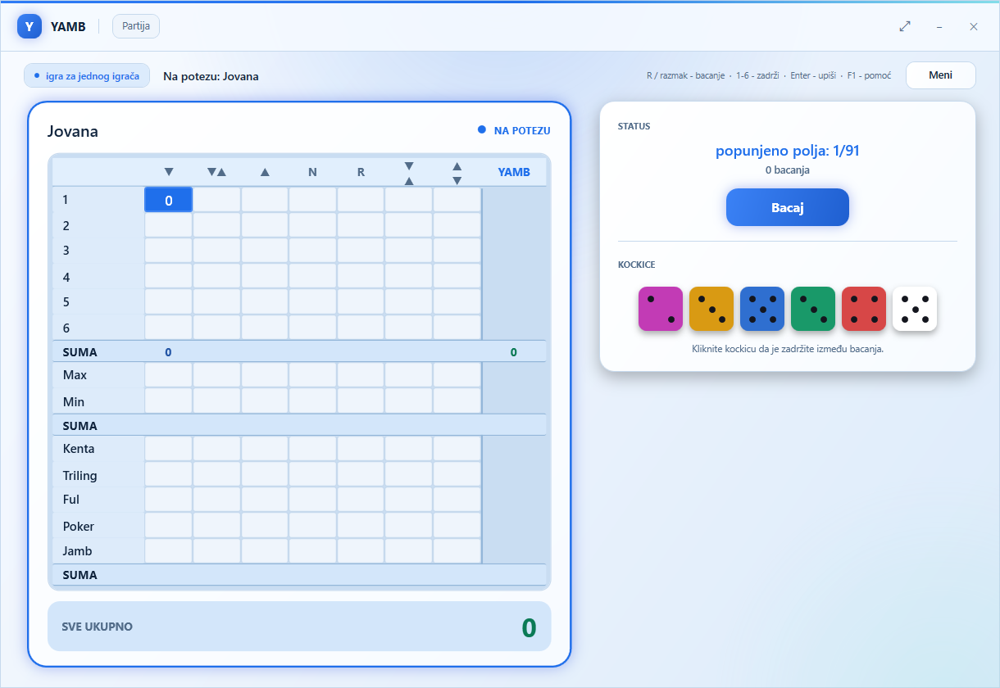
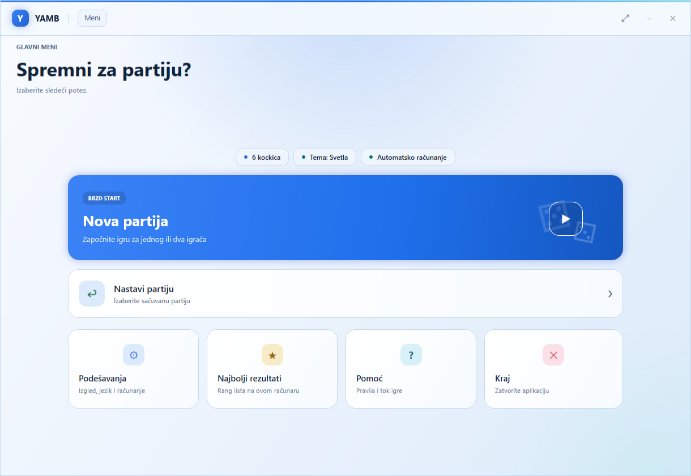
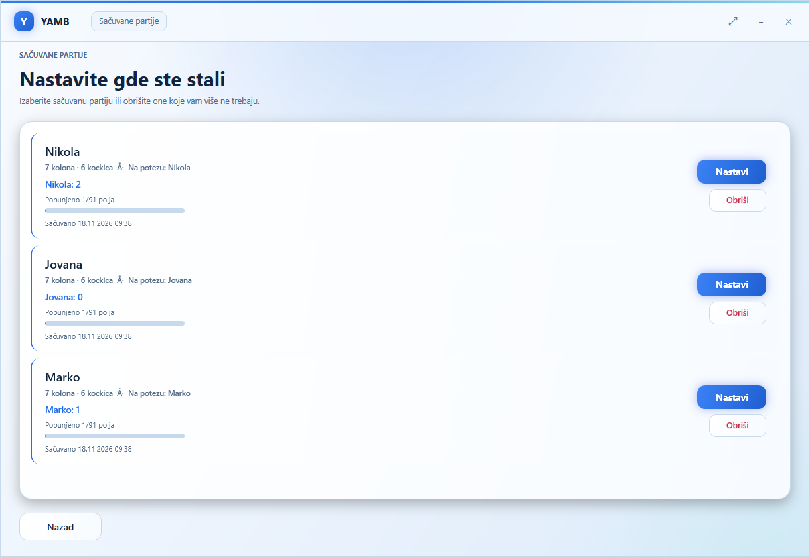
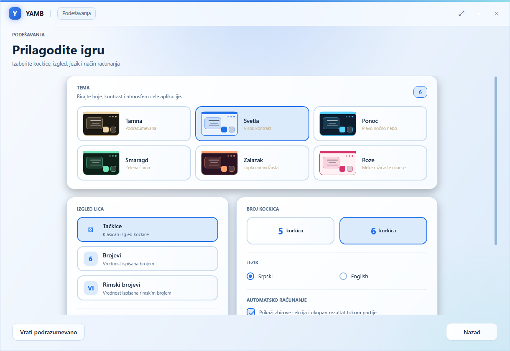
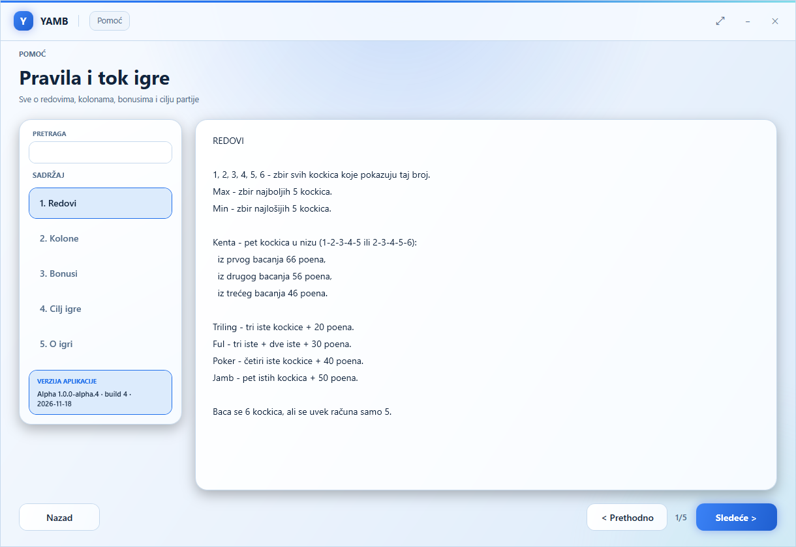
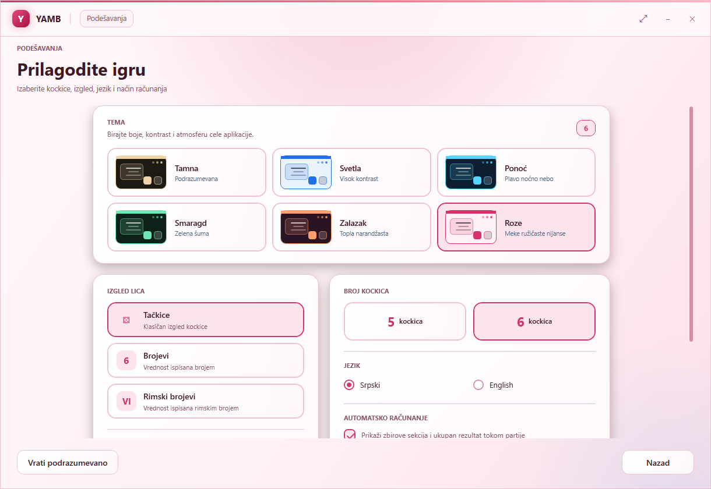
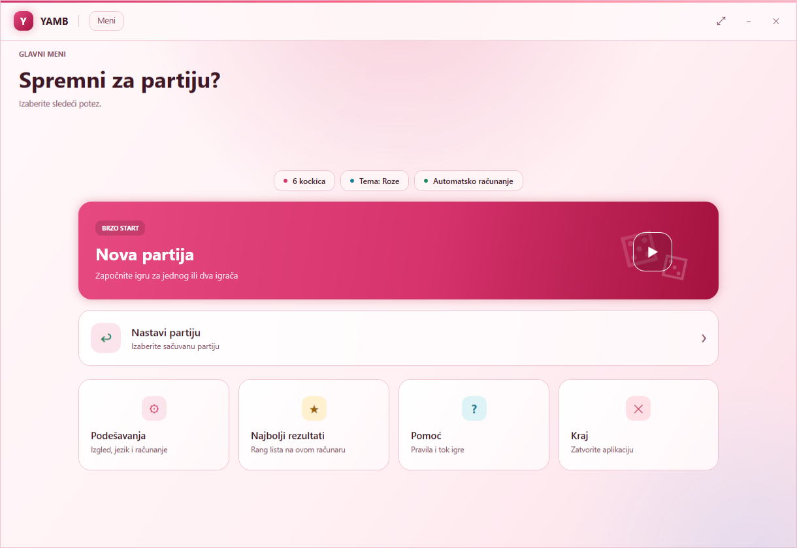
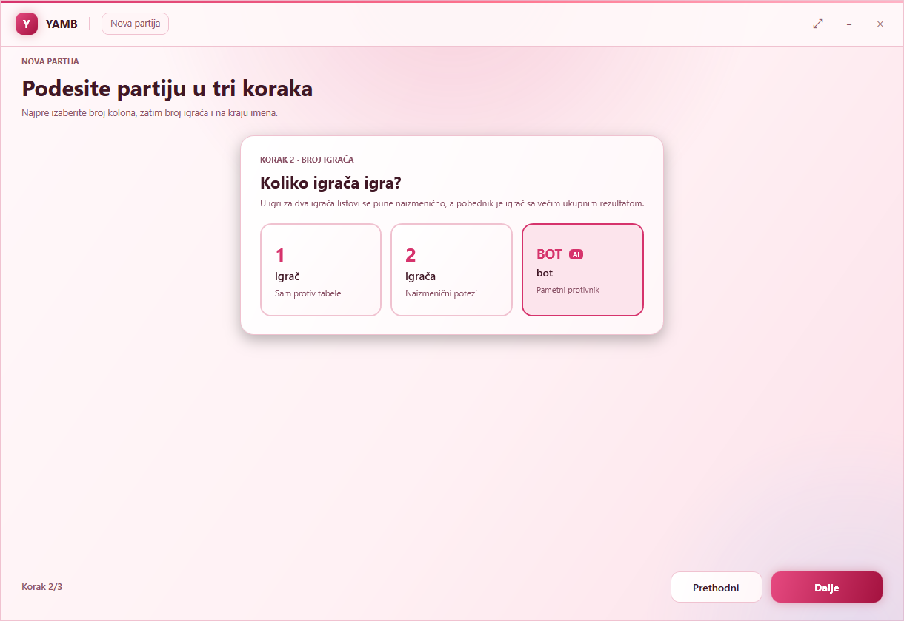
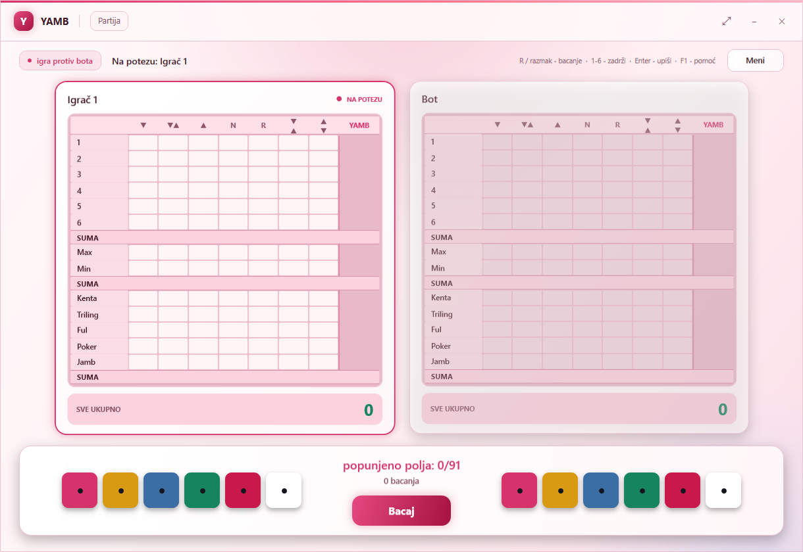

# Yamb

[](https://github.com/Gligorijes/Yamb-C-/actions/workflows/ci.yml)

A modern Windows implementation of the Balkan dice game **Yamb**, built with .NET 8 and WPF.



## Features

- Single-player, local two-player and play-against-bot games.
- 4 to 10 score columns, with 5 or 6 dice.
- Automatic and manual scoring modes.
- Manual announcement confirmation after the third roll.
- Saved-game chooser with player summaries, progress, continue and delete actions.
- Local top-50 leaderboard with a separate entry for each player.
- Six themes: Dark, Light, Midnight, Emerald, Sunset and Rose.
- Serbian and English interface.
- Keyboard shortcuts, F1 help and searchable rules.
- Pips, numbers and Roman-numeral dice faces.
- Special celebration for a handwritten Jamb in the Hand column.

## Screenshots

| Menu | Saved games |
| --- | --- |
|  |  |

| Settings | Help and rules |
| --- | --- |
|  |  |

| Rose settings | Rose menu |
| --- | --- |
|  |  |

| Bot mode | Bot game |
| --- | --- |
|  |  |

## Keyboard shortcuts

| Key | Action |
| --- | --- |
| `R` or `Space` | Roll the dice |
| `1` to `6` | Hold or release the matching die |
| `Enter` | Write the announced cell after the third roll |
| `F1` | Open Help on the columns page |

Shortcuts are ignored while a dialog is open.

## Architecture

The solution follows a Clean Architecture layout:

- `Yamb.Domain` - game rules, scoring and domain model.
- `Yamb.Application` - use cases, DTOs and service interfaces.
- `Yamb.Infrastructure` - SQLite persistence with EF Core.
- `Yamb.Presentation` - presentation contracts.
- `Yamb.Presentation.Wpf` - WPF desktop application.
- `tests` - domain, application and infrastructure tests.

## Requirements

- Windows 10 or newer.
- [.NET 8 SDK](https://dotnet.microsoft.com/download/dotnet/8.0).

## Build and run

```powershell
dotnet build YambGame.sln -c Release
dotnet run --project src/Yamb.Presentation.Wpf/Yamb.Presentation.Wpf.csproj -c Release
```

## Tests

```powershell
dotnet test YambGame.sln -c Release
```

The GitHub Actions workflow runs the same build and test commands on `windows-latest`.

## Development tools

Build the Release configuration first, then run:

```powershell
powershell -ExecutionPolicy Bypass -File tools/wpf-e2e-test.ps1
powershell -ExecutionPolicy Bypass -File tools/wpf-screenshots.ps1
```

- `wpf-e2e-test.ps1` drives the real WPF app through UI Automation and checks the main flows. It temporarily backs up and then restores `%LOCALAPPDATA%\Yamb`.
- `wpf-screenshots.ps1` regenerates the images in `docs/screenshots`, also restoring local data afterwards.
- `wpf-visual-check.ps1` captures diagnostic screenshots and colour metrics for theme checks.

## Local data

Saved games, settings and the leaderboard are stored locally in:

```text
%LOCALAPPDATA%\Yamb
```

The database and local settings are intentionally excluded from the repository.

## Versioning

The current alpha version is shown in the app under **Help > About**. Build history is documented in [CHANGELOG.md](CHANGELOG.md).
